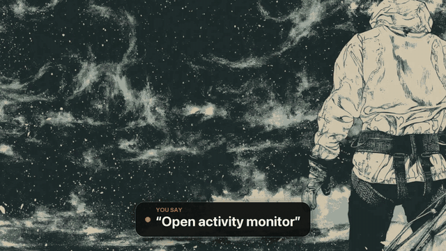

# omarchy-handsfree

Control [Omarchy](https://omarchy.org) with your voice and your eyes.



▶ [Full 49-second demo with sound](docs/demo.mp4): every command is spoken; nothing is typed or clicked by hand.

- Say **"open browser"**, **"open Google"**, **"open Claude Code"**, **"search for arch wiki hyprland"**, **"workspace two"**, **"type hello world"**, or turn on dictation and talk.
- Turn on eye tracking and the pointer follows your gaze. Click by saying **"click"**, by holding your gaze still, or by a long deliberate blink.
- For small buttons, say **"grid"**, then a number, to zoom in on the right spot.

Everything runs **offline** on your machine (Whisper for speech, MediaPipe for eyes). No audio or video leaves your computer. The microphone and camera are off until you allow them, and a bar indicator shows when either one is in use.

Tested on Omarchy 4 (Hyprland 0.56 with its Lua config, the Quickshell bar) in [Try Omarchy](https://tryomarchy.dev) on an Apple Silicon Mac, with the Mac's microphone and camera passed through.

## Install

On Omarchy, run:

```bash
git clone <this repo> ~/omarchy-handsfree
cd ~/omarchy-handsfree
./install.sh
```

The installer is safe to re-run. It:

1. installs a few packages with pacman (`wtype`, `uv`, `gtk4-layer-shell`, `python-gobject`, `portaudio`, ...)
2. creates a Python 3.12 environment in `~/.local/share/omarchy-handsfree` and links `handsfree` and `handsfree-ctl` into `~/.local/bin`
3. downloads the offline models (Whisper `base.en` and MediaPipe's face landmarker)
4. asks before adding a udev rule so the program can click and press keys. The rule uses `uaccess`, which gives access only to the logged-in user, not the `input` group.
5. enables a systemd user service
6. asks before adding the hotkeys below to `~/.config/hypr/bindings.lua`
7. adds a microphone/camera indicator to the Omarchy bar (or prints a Waybar module on older setups)
8. asks for microphone and camera consent, then runs `handsfree-ctl doctor`

Add `--with-wake` to also install a wake word ("hey jarvis") for continuous listening.

## Hotkeys

| Keys | Action |
| --- | --- |
| `Super + Alt + V` | Listen for one command. Press again to stop early. |
| `Super + Shift + Alt + V` | Continuous listening on/off |
| `Super + Alt + E` | Eye tracking on/off |
| `Super + Alt + M` | Mouse grid on/off |

These keys don't clash with Omarchy's defaults. Omarchy's own dictation (`Super + Ctrl + X`, `F9`) keeps working alongside this.

## Voice commands

| Say | Does |
| --- | --- |
| open browser · open terminal · open claude code | Omarchy launchers |
| open google / youtube / github / claude / gmail / arch wiki | opens the site |
| open *any app* (firefox, obsidian, files, ...) | launches it from its .desktop entry |
| search for *...* · search youtube for *...* | web search |
| type *...* · press *control l* · new line | typing and keys |
| undo · copy · paste · select all · save · new tab · close tab · go back · reload | common shortcuts |
| click · double click · right click · scroll down · hold / release | mouse at the pointer |
| close window · fullscreen · workspace *three* · move to workspace *two* · focus left | Hyprland |
| start dictation / stop dictation | type everything you say |
| start eye tracking · calibrate · grid · *five* · close grid | eyes |
| start listening · stop listening | continuous mode |

Add your own commands in `~/.config/handsfree/commands.toml`; they take priority over the defaults. For example:

```toml
[[command]]
say = ["open notes", "notes"]
run = "omarchy-launch-or-focus obsidian"

[[command]]
say = "search the wiki for {text}"
url = "https://wiki.archlinux.org/index.php?search={text}"

[sites]
"hacker news" = "https://news.ycombinator.com"
```

The packaged `commands.toml` documents every action type (`run`, `url`, `app`, `hypr`, `type`, `key`, `mouse`, `internal`) and slot (`{text}`, `{n}`, `{site}`, `{app}`, `{key}`). Run `handsfree-ctl say <words>` to test a phrase without the microphone.

## Eye tracking

1. Say "start eye tracking" (or press `Super + Alt + E`).
2. Say "calibrate" and look at each dot until it moves. There are 9 dots, then 4 check dots, about 25 seconds in total.
3. A notification reports the average error in pixels. Laptop webcams usually land at 80–200 px, which is enough for windows, tabs and big buttons.
4. For anything smaller, say "grid" and then the number of the cell. The grid zooms in until the cells are small; then say "click".

Optional click methods are set in `~/.config/handsfree/config.toml`:

```toml
[gaze]
dwell_ms = 900        # click after looking at one spot for 0.9 s
blink_click_ms = 600  # click with a deliberate blink of 0.6 s or longer
```

Tips: face the camera with even light from the front, avoid glare on glasses, and recalibrate after moving the laptop or changing your seat. Calibration is stored per monitor.

## Configuration

`~/.config/handsfree/config.toml` overrides the packaged defaults (the installer prints their path). Common changes:

```toml
[voice]
model = "small.en"        # more accurate, slower; "tiny.en" is fastest (re-run install.sh)
energy_threshold = 0.02   # raise it in a noisy room
wake_word = "hey_jarvis"  # continuous mode waits for this (needs --with-wake)
input_device = "pulse:alsa_input.usb-Blue_Yeti-00.analog-stereo"  # a specific mic, by PipeWire name

[gaze]
camera = "/dev/video2"     # default "auto" finds the first working camera
calibration_points = 16   # 4x4 grid, more accurate
```

## Privacy

- Nothing runs until `handsfree-ctl setup` records your consent. Run it again to revoke consent; that also turns off any device that is running.
- With push-to-talk, the microphone is open only from the key press until you stop talking. Continuous mode keeps it open until you say "stop listening".
- The camera is open only while eye tracking is on.
- No network access at runtime. The models are downloaded once during install.

## Troubleshooting

```bash
handsfree-ctl doctor                 # checks packages, permissions, models, consent
journalctl --user -u handsfree -f    # live log of what was heard and done
handsfree --dry-run -v               # run in a terminal, log actions instead of doing them
```

- **"Not understood"**: check the log for what Whisper heard, and add that phrase to your commands.
- **Random commands or "not understood" in continuous mode**: continuous listening hears everything, including a TV or people talking. Use push-to-talk (`Super + Alt + V`) or a wake word in a noisy room.
- **Microphone picks the wrong device**: set `input_device = "pulse:<name>"` using a name from `pactl list short sources`.
- **Clicks or keys do nothing**: check that `/dev/uinput writable` is `ok` in `doctor`; log out and back in after installing.
- **No overlay during calibration**: `doctor` must show `gtk4-layer-shell` and the overlay Python as `ok`.
- **Commands are slow**: use `model = "tiny.en"` (then re-run `./install.sh` to download it), or a GPU with CUDA (`device = "auto"` picks it up).

## Uninstall

```bash
./uninstall.sh           # keeps your settings and calibration
./uninstall.sh --purge   # removes those too
```

## Development

The daemon core has no required dependencies, so the logic tests run anywhere with Python 3.11+:

```bash
PYTHONPATH=src python3 -m unittest discover -s tests -t .
```

Layout: `audio/` (mic, endpointing, Whisper, wake word), `intents/` (parser, apps, actions), `gaze/` (features, calibration, mapper, filter, clicks, grid), `desktop/` (Hyprland IPC, uinput, wtype, overlay, notifications), `daemon.py` (ties it together), `ctl.py` (CLI). Design decisions are recorded in [NOTES.md](NOTES.md).
